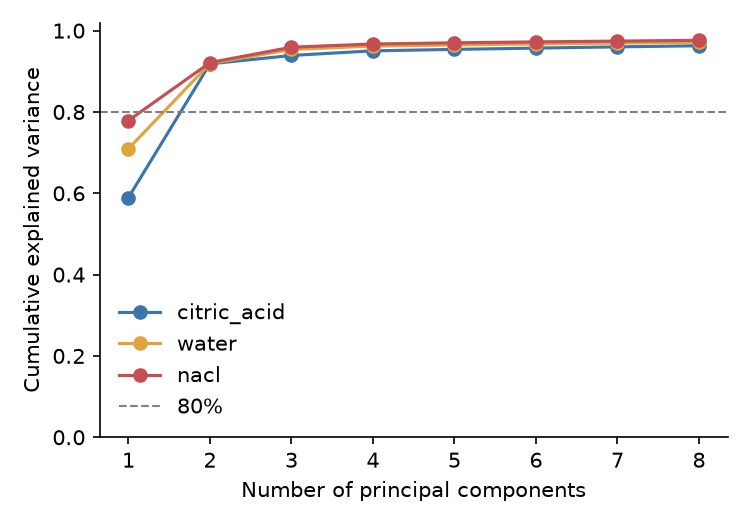
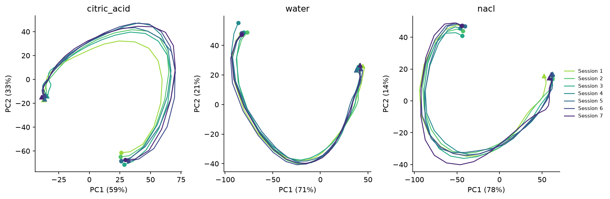

# taste-population-dynamics

Do cortical neuron populations keep a stable, trackable representation of a taste across repeated sessions without any learning? This repository contains the analysis pipeline from a computational-neuroscience course project that addressed that question with multi-session taste-delivery recordings. It covers spike alignment, PSTHs, unit screening, PCA trajectories, and shuffle-based tests of session similarity, endpoint convergence and trajectory velocity.

> **No real data is included.** The pipeline runs on a synthetic generator that reproduces the experimental design (sessions × repeated blocks of randomized tastes) and has a known low-dimensional trajectory, so every step can be tested against ground truth.

**Status:** work in progress, built step by step.

| Step | Content | Status |
|---|---|---|
| 1 | Project skeleton, synthetic data, pickle-free I/O | ✅ |
| 2 | Spike alignment, firing rates, PSTHs, population tensor | ✅ |
| 3 | Unit screening: responsiveness and taste specificity | ✅ |
| 4 | PCA trajectories and demo figures | ✅ |
| 5 | Shuffle tests: session similarity, endpoints, velocity | ⏳ |

## Results on synthetic data

Generated with `python scripts/demo.py` (seed 0).

**Single units.** Rasters (top; trials grouped by taste) and PSTHs (bottom) of three taste-specific units.


**Dimensionality.** Cumulative variance explained by PCA of each taste's population activity.



**Population trajectories.** Each session's trajectory in the first two PCs (circle: delivery; triangle: 3 s later). Trajectories are consistent across sessions and slow down toward the end of the response window.



## Synthetic data

`make_dataset()` simulates 7 sessions starting 400 s apart. Each session has 10 blocks in which water, NaCl and citric acid are delivered once each in random order, 12 s apart.

Model:
- A shared 2-D latent trajectory rotates and slows over the 3 s after each delivery; each taste starts at a different phase.
- Taste-responsive units (70%) follow the latent through per-unit loadings and add a taste-specific early response.
- Firing rate = baseline × exp(drive), with lognormal baselines (median 5 Hz); spikes are Poisson.
- Loadings drift across sessions as a random walk (`session_drift=0.05`; set to `0` to disable).

Ground truth is returned in `dataset.truth`, so tests can check whether each analysis recovers it.

**Not modelled:** refractory periods, noise correlations between units, trial-to-trial variability beyond Poisson, response latency, temporal modulation in non-responsive units, and abrupt changes between sessions.

## Data format

To run the pipeline on your own recording, provide two files:

- `events.csv`: one row per taste delivery, with columns `session`, `trial`, `taste`, `time_s`
- `spikes.npz`: two equal-length arrays, `spike_times_s` and `unit_ids` (the layout spike sorters such as Kilosort export)

All times are in seconds. Load them with `load_dataset("path/to/folder")`.

## Installation (Windows, Anaconda Prompt)

```bat
cd path\to\taste-population-dynamics
python -m venv .venv
.venv\Scripts\activate
python -m pip install --upgrade pip
pip install -e ".[dev]"
```

## Usage

```bat
python scripts\make_synthetic_data.py
python scripts\demo.py
pytest
```

```python
from taste_dynamics import make_dataset, save_dataset, load_dataset

ds = make_dataset(n_units=100, n_sessions=7, n_blocks=10, seed=0)
ds.events.head()
save_dataset(ds, "data/synthetic")

from taste_dynamics.preprocessing import population_tensor, psth

# Session-wise population PSTHs for one taste: (sessions, bins, units), spikes/s
tensor, bin_centers, unit_ids = population_tensor(
    ds, "nacl", window=(0.0, 3.0), bin_s=0.1, sigma_s=0.15
)

# Single-unit PSTH around all deliveries
rates, edges = psth(ds.spikes[0], ds.events["time_s"], window=(-1.0, 3.0), bin_s=0.1)

from taste_dynamics.screening import find_responsive_units, find_taste_specific_units

# One row per unit: rates, test statistic, raw and corrected p-values, verdict
responsive = find_responsive_units(ds, alpha=0.01, correction="fdr_bh")
specific = find_taste_specific_units(ds, alpha=0.01, correction="fdr_bh")

from taste_dynamics.dynamics import pca_trajectories

# PCA fitted on all sessions together; trajectories: (sessions, bins, components)
# normalize: None (rates in spikes/s, default), "zscore" or "soft"
result = pca_trajectories(tensor, n_components=4, normalize=None)
result.trajectories, result.explained_variance_ratio
```

### Preprocessing choices

- Time windows include their start and exclude their end, `[start, end)`, so no spike is counted twice.
- PSTHs are averaged over trials and expressed in spikes/s; smoothing width is set in seconds (`sigma_s`).
- Units can optionally be normalized before PCA (`normalize="zscore"` or `"soft"`; default `None`). Soft normalization follows Churchland et al. (2012).

## Repository layout

```
src/taste_dynamics/   package code
  synthetic.py        synthetic experiment generator with ground truth
  io.py               save/load events.csv + spikes.npz
  preprocessing.py    spike alignment, firing rates, PSTHs, population tensor
  screening.py        taste responsiveness and specificity tests
  dynamics.py         PCA trajectories
  plotting.py         rasters, PSTHs, explained variance, trajectories
scripts/              make_synthetic_data.py, demo.py
figures/              figures produced by demo.py
tests/                pytest test suite (run automatically by GitHub Actions)
```

## References

Churchland, M. M., Cunningham, J. P., Kaufman, M. T., Foster, J. D., Nuyujukian, P., Ryu, S. I., & Shenoy, K. V. (2012). Neural population dynamics during reaching. *Nature*, 487, 51–56. https://doi.org/10.1038/nature11129

## Authors

- Ron Gerbi
- Ofek Sourani (co-author of the original course project)
