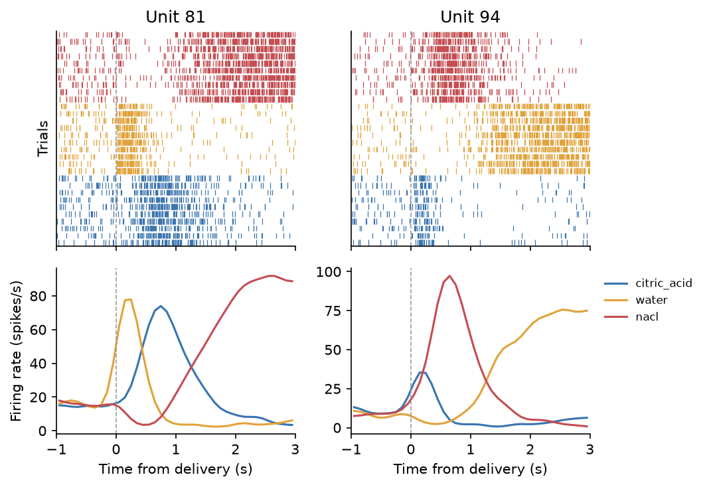

# taste-population-dynamics

Do populations of cortical neurons maintain a stable, trackable representation of a taste across repeated sessions? This repository contains the analysis pipeline from a computational neuroscience course project (Sagol School of Neuroscience, Tel Aviv University) that addressed this question using multi-session recordings from the gustatory cortex of a rat during taste delivery. The pipeline covers spike alignment, PSTHs, unit screening, PCA trajectories, and several tests of stability across sessions.

> **No real data is included.** The pipeline was developed for real recordings, which remain unpublished. A synthetic data generator that reproduces the experimental design stands in for them: it produces the example figures and lets the tests check each step against a known ground truth.

**Status:** work in progress, built step by step.

| Step | Content | Status |
|---|---|---|
| 1 | Project skeleton, synthetic data, pickle-free I/O | ✅ |
| 2 | Spike alignment, firing rates, PSTHs, population tensor | ✅ |
| 3 | Unit screening: responsiveness and taste specificity | ✅ |
| 4 | PCA trajectories and demo figures | ✅ |
| 5a | Stability across sessions: session similarity, endpoints, drift | ✅ |
| 5b | Trajectory velocity: early vs. late, repeated-measures ANOVA | ⏳ |

## Pipeline

1. **Load** spike times and taste-delivery times (`io`).
2. **Preprocess:** align spikes to each delivery, bin (100 ms) and smooth (Gaussian, σ = 150 ms) into PSTHs, and stack them into a sessions × time bins × units array for each taste (`preprocessing`).
3. **Screen units:** taste responsiveness (paired t-test, 3 s before vs. after delivery) and taste specificity (one-way ANOVA across tastes), with optional FDR or Bonferroni correction (`screening`).
4. **Reduce dimensions:** PCA fitted on all sessions together, giving one trajectory per session in a shared space; units can optionally be z-scored or soft-normalized first (`dynamics`).
5. **Test stability across sessions:** distances between sessions' population responses and between their endpoints, each against a shuffled null, plus a Mantel test of whether sessions drift apart over time (`stability`).
6. *Planned:* trajectory velocity, early vs. late in the response, with a repeated-measures ANOVA.

Notes: time windows include their start and exclude their end; shuffle-test p-values are computed from the shuffle distribution and are seeded; soft normalization follows Churchland et al. (2012).

## Example output

The pipeline was built for, and applied to, multi-session Neuropixels recordings. Those recordings are unpublished and not included here. The figure below is produced from **simulated data**; it demonstrates the analyses and is not a finding.



Rasters (top; trials grouped by taste) and PSTHs (bottom) of two taste-responsive units. An overview of the population analyses for one taste will be added together with the velocity analysis.

## Synthetic data

`make_dataset()` simulates 7 sessions starting 400 s apart. Each session has 10 blocks in which water, NaCl and citric acid are delivered once each in random order, 12 s apart.

Model:
- A shared 2-D latent trajectory rotates and slows over the 3 s after each delivery; each taste starts at a different phase.
- Taste-responsive units (70%) follow the latent through per-unit loadings and add a taste-specific early response.
- Firing rate = baseline × exp(drive), with lognormal baselines (median 5 Hz); spikes are Poisson.
- Loadings drift across sessions as a random walk (`session_drift=0.05`; set to `0` to disable).

Ground truth is returned in `dataset.truth`, so tests can check whether each analysis recovers it.

**Not modelled:** refractory periods, noise correlations between units, trial-to-trial variability beyond Poisson, response latency, temporal modulation in non-responsive units, and abrupt changes between sessions.

## Installation and use (Windows, Anaconda Prompt)

```bat
python -m venv .venv
.venv\Scripts\activate
pip install -e ".[dev]"
python scripts\demo.py
pytest
```

`demo.py` runs the whole pipeline on simulated data and saves one figure per analysis, each with all three tastes, to `figures/` (`--normalize soft` changes the PCA input). Only the figure above is committed to the repository.

## Data format

To run the pipeline on a real recording, provide two files and load them with `load_dataset("path/to/folder")`:

- `events.csv`: one row per taste delivery, with columns `session`, `trial`, `taste`, `time_s`
- `spikes.npz`: two equal-length arrays, `spike_times_s` and `unit_ids` (the layout spike sorters such as Kilosort export)

All times are in seconds.

## Repository layout

- `src/taste_dynamics/`: the package, one module per pipeline step (`io`, `preprocessing`, `screening`, `dynamics`, `stability`), plus `synthetic` (simulated data) and `plotting`
- `scripts/`: `demo.py` (runs the pipeline and saves the figures) and `make_synthetic_data.py` (writes a simulated dataset to disk)
- `tests/`: pytest suite, run automatically by GitHub Actions on every pull request
- `figures/`: the README figure; `demo.py` writes its other figures here too (not committed)

## References

Churchland, M. M., Cunningham, J. P., Kaufman, M. T., Foster, J. D., Nuyujukian, P., Ryu, S. I., & Shenoy, K. V. (2012). Neural population dynamics during reaching. *Nature*, 487, 51–56. https://doi.org/10.1038/nature11129

## Authors

- Ron Gerbi
- Ofek Sourani (co-author of the original course project)
